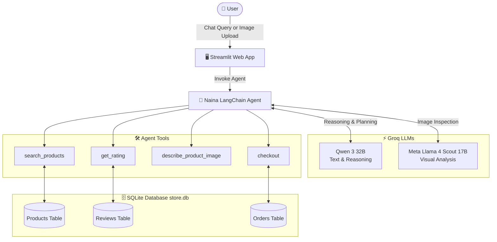

# 🛒 Naina — AI Shopping Assistant

[](https://www.python.org/)
[](https://streamlit.io/)
[](https://www.langchain.com/)
[](https://groq.com/)
[](https://www.sqlite.org/)
[](LICENSE)

**Naina** is an intelligent, multimodal AI Shopping Assistant powered by **LangChain** and ultra-fast **Groq** LLMs. Naina bridges natural language conversations and visual search to help users discover products, check customer ratings, apply granular filters (price, organic status), and place orders seamlessly.

---

## 🌟 Key Features

- **💬 Conversational Product Discovery**: Search products using natural everyday language (e.g., *"Find organic honey under $20 with at least 4.5 stars"*).
- **📸 Multimodal "Shop by Image"**: Upload product photos (e.g. honey jar, oats). The vision agent analyzes the image, identifies product attributes, and finds matching items in the store catalog.
- **⭐ Real-Time Review & Rating Intelligence**: Aggregates customer reviews and calculates average ratings to ensure you only get the highest-rated recommendations.
- **🛠️ Agentic Tool Execution**: Powered by LangChain agent architecture equipped with specialized tools for catalog search, visual inspection, rating aggregation, and order placement.
- **📦 Autonomous Checkout Flow**: Direct-from-chat order execution with unique order ID generation and persistent SQLite order history.
- **💻 Interactive Streamlit Interface**: Clean, responsive web UI with chat history, instant image previews, and friendly progress spinners.

---

## 🧠 System Architecture



---

## 🛠️ Agent Tools Overview

| Tool Name | Description | Key Parameters |
|-----------|-------------|----------------|
| `describe_product_image` | Uses Groq's Vision LLM to extract product type, search keywords, and organic certification from uploaded photos. | `image_path: str` |
| `search_products` | Queries the product catalog by keyword across title, category, and description with optional filters. | `query: str`, `max_price: float`, `is_organic: bool` |
| `get_rating` | Calculates average customer ratings and review count from the SQLite `reviews` table. | `product_id: int` |
| `checkout` | Finalizes purchase, writes an order record to the `orders` table, and returns confirmed order receipt. | `product_id: int` |

---

## 📁 Repository Structure

```plaintext
Shopping-Assistant-Naina-/
├── src/
│   ├── app.py                 # Streamlit web application & UI logic
│   ├── shopping_agent.py      # LangChain agent definition, system prompts & tools
│   ├── reviews_api.py         # Customer review calculation & aggregation logic
│   ├── setup_db.py            # SQLite database schema creation & seed data
│   ├── store.db               # SQLite database (products, reviews, orders)
│   └── resources/             # Sample images for testing image search
│       ├── honey.png          # Sample product image: Honey
│       ├── oats.png           # Sample product image: Oats
│       └── elephant.png       # Test image: Non-store product
├── .env.sample                # Sample environment variables template
├── .gitignore                 # Ignored files and directories
├── LICENSE                    # MIT License
├── pyproject.toml             # Project dependencies and package metadata
├── README.md                  # Project documentation
└── uv.lock                    # Locked dependency versions (uv package manager)
```

---

## 🗄️ Database Schema

The store is backed by SQLite (`src/store.db`) with three relational tables:

- **`products`**: `id`, `name`, `category`, `price`, `description`, `is_organic`
- **`reviews`**: `id`, `product_id`, `rating`, `reviewer_name`, `review_text`
- **`orders`**: `id`, `product_id`, `product_name`, `price`, `ordered_at`

---

## 🚀 Getting Started

### Prerequisites

- **Python**: 3.10 or higher (Python 3.11+ recommended)
- **Groq API Key**: Obtain a free API key from [Groq Console](https://console.groq.com/).

---

### 1. Clone the Repository

```bash
git clone https://github.com/SamarthPachpile/Shopping-Assistant-Naina-.git
cd Shopping-Assistant-Naina-
```

---

### 2. Set Up a Virtual Environment

#### Option A: Using `uv` (Recommended)

```bash
uv sync
```

#### Option B: Using standard `venv` and `pip`

```bash
# Windows
python -m venv .venv
.venv\Scripts\activate

# macOS / Linux
python3 -m venv .venv
source .venv/bin/activate

pip install -e .
```

---

### 3. Configure Environment Variables

Create a `.env` file in the root directory by copying `.env.sample`:

```bash
cp .env.sample .env
```

Open `.env` and configure your API keys:

```env
GROQ_API_KEY=gsk_your_groq_api_key_here
GOOGLE_API_KEY=your_google_api_key_here          # Optional / Secondary provider
LANGSMITH_API_KEY=your_langsmith_api_key_here    # Optional: For tracing & observability
```

---

### 4. Initialize the Database (Optional)

A populated `store.db` is already included in `src/`. If you want to reset or re-seed the catalog and mock reviews, run:

```bash
python src/setup_db.py
```

---

### 5. Launch the Application

Start the Streamlit user interface:

```bash
streamlit run src/app.py
```

Once started, open your browser and navigate to `http://localhost:8501`.

---

## 💡 Example Usage & Prompts

### 1. Conversational Queries

- **Budget & Attribute Filter**:
  > *"I want to buy organic honey with 4.5+ rating and less than $20 price."*
- **Category Browsing**:
  > *"Show me cold-pressed cooking oils available in the store."*
- **Dietary Preferences**:
  > *"What organic snacks or nuts do you have under $15?"*

### 2. Ordering Items

- After Naina lists candidate items with IDs:
  > *"Order the first one"* or *"Place order for item #1"*
- Naina will invoke `checkout` and output confirmation details:
  > *"Order #1 confirmed! 'Organic Raw Honey' has been successfully ordered for $14.99. Your order will arrive in 3-5 business days."*

### 3. Image Search

1. In the sidebar, click **"Upload product image"**.
2. Select an image from `src/resources/` (e.g., `honey.png` or `oats.png`).
3. Click **"Find similar products"**.
4. Naina will inspect the image, summarize its contents, and query the catalog for matching stock.

---

## ⚡ Tech Stack

- **Framework**: [LangChain](https://www.langchain.com/)
- **Inference Engine**: [Groq](https://groq.com/)
  - Language Model: `qwen/qwen3-32b`
  - Vision Model: `meta-llama/llama-4-scout-17b-16e-instruct`
- **Frontend**: [Streamlit](https://streamlit.io/)
- **Database**: [SQLite](https://www.sqlite.org/)
- **Package Management**: [uv](https://docs.astral.sh/uv/) / `pip`

---

## 📄 License

This project is licensed under the [MIT License](LICENSE).
